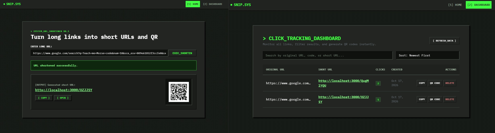

<div align="center">
  <br />
    <a>
      
    </a>

  <br />
  <h3 align="center"> Snip - URL Shortner, QR Generator </h3>
</div>

## <a name="table">Table of Contents</a>

1. [Introduction](#introduction)
2. [Key Features](#key-features)
3. [Project Structure](#project-structure)
4. [Quick Start](#quick-start)


## <a name="introduction">Introduction</a>

Shorten, share, and track with ease. Instantly convert lengthy URLs into custom short links and high-resolution QR codes, complete with full management controls in a single streamlined hub.

## <a name="key-features">Key Features</a>

- Smart URL Shortener — Generate unique, compact links in seconds.
- Instant QR Generation — Produce dynamic QR codes directly from your short URLs.
- Intuitive Analytics & History — Monitor and organize all past links from a single view.
- Full Link Control — Copy, preview, refresh, or remove links seamlessly.


## <a name="project-structure">Project Structure</a>

```bash
snip/
├── client/                     # Angular Frontend
│   ├── src/
│   │   ├── app/
│   │   │   ├── components/
│   │   │   │   ├── dashboard/
│   │   │   │   ├── navbar/
│   │   │   │   └── home/
│   │   │   │
│   │   │   ├── models/
│   │   │   │   └── url-item.ts
│   │   │   │
│   │   │   ├── services/
│   │   │   │   └── url.ts
│   │   │   │
│   │   │   ├── app.component.ts
│   │   │   ├── app.config.ts
│   │   │   └── app.routes.ts
│   │   │
│   │   ├── main.ts
│   │   ├── styles.css
│   │   └── index.html
│   │
│   ├── angular.json
│   ├── tsconfig.json
│   └── package.json
│
├── server/                     # Backend (Node.js)
│   ├── src/
│   │   ├── data/urls.json
│   │   ├── routes/urlRoutes.js
│   │   └── utils/fileStorejs
│   ├── server.js
│   └── package.json
│
├── .gitignore
└── README.md

```

## <a name="quick-start">Quick Start</a>

### Prerequisites

- npm or Yarn
- Node.js (v18+)
- Angular CLI (optional)

1. Clone
```bash
# Clone the Repository
git clone https://github.com/sdulal412/snip.git
cd snip
```

2. Backend
```bash
cd server

# Install dependencies (only the first time)
npm install

# Run the local server on http://localhost:3000
npm run dev
```

3. Frontend

```bash
cd client

# Install dependencies (only the first time)
npm install

# Runs the local on http://localhost:4200
ng serve

```